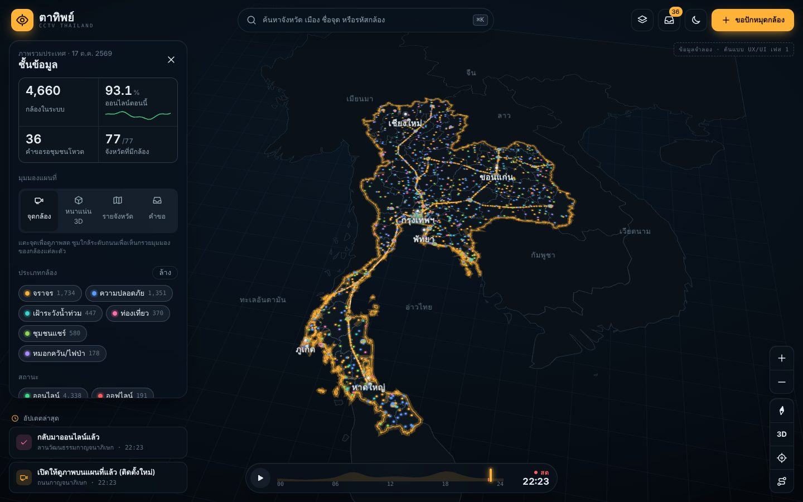
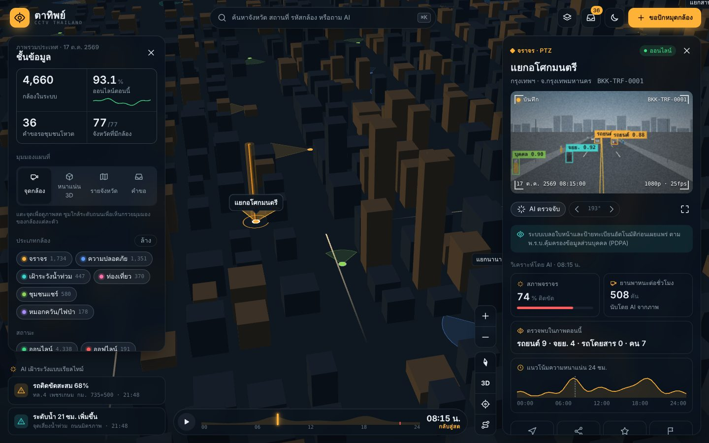
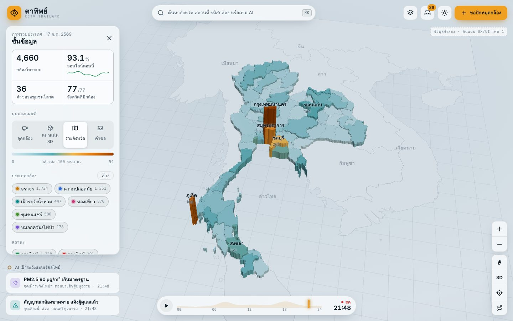
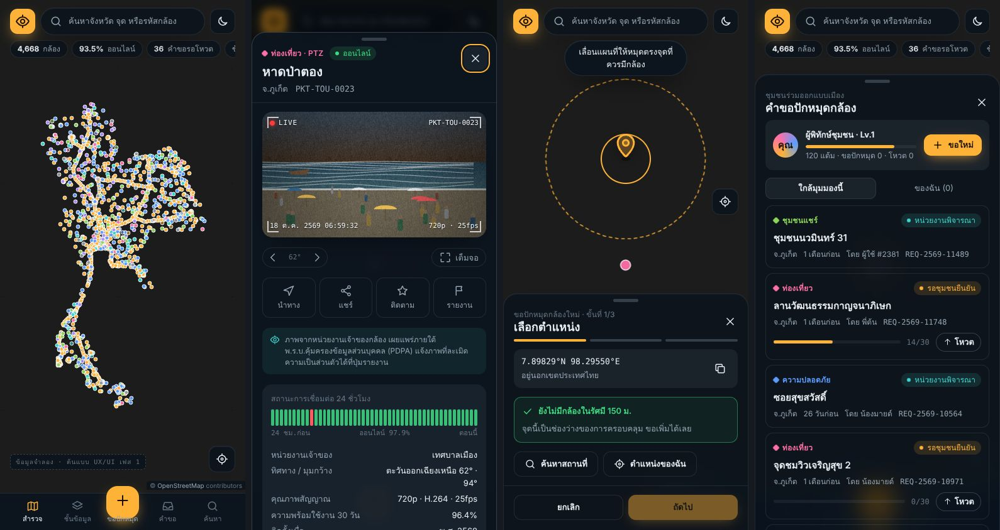

# ตาทิพย์ · CCTV Thailand

แพลตฟอร์มรวมกล้อง CCTV ทั่วประเทศไทยบน **แผนที่ 3 มิติ** ให้ประชาชนทั่วไปค้นหา ดูภาพ และ **ขอปักหมุดกล้องใหม่** ได้เอง

> **สถานะ: เฟส 1 · ออกแบบ UX/UI ด้วยข้อมูลจำลอง**
> ทุกตำแหน่ง สถานะ ภาพ และค่าวิเคราะห์ในต้นแบบเป็นข้อมูลจำลองเพื่อการออกแบบเท่านั้น



| รายละเอียดกล้อง + AI | มุมมองรายจังหวัด (ธีมกลางวัน) |
|---|---|
|  |  |



## เปิดดูต้นแบบ

**ออนไลน์ (GitHub Pages):** https://giganto-th.github.io/cctv/ — deploy อัตโนมัติด้วย `.github/workflows/pages.yml` ทุกครั้งที่ push ไฟล์ใน `prototype/`
(ตั้งค่าครั้งแรก: Settings → Pages → Build and deployment → Source เลือก **GitHub Actions**)

**บนเครื่อง:**

```bash
npm run dev          # เปิด http://localhost:5173 (ใช้ Node 20+ ไม่ต้องติดตั้งแพ็กเกจ)
```

หรือเปิด `prototype/index.html` ผ่านเว็บเซิร์ฟเวอร์ไฟล์นิ่งใดก็ได้ ต้องต่ออินเทอร์เน็ตเพื่อโหลด deck.gl และฟอนต์จาก CDN

สร้างไฟล์ HTML เดียวไว้แชร์:

```bash
npm run build:single # → dist/tathip.html
```

## ลองทำสิ่งเหล่านี้

- **⌘K / Ctrl+K** หรือแตะช่องค้นหา แล้วพิมพ์ "กล้องจราจรที่รถติดตอนนี้ในกรุงเทพ" หรือ "จุดเฝ้าระวังน้ำท่วมที่ระดับน้ำสูง"
- แตะจุดกล้องเพื่อดู **ภาพสดจำลอง + AI ตรวจจับ** (เบลอหน้าและทะเบียนให้เห็น) กล้อง PTZ หมุนได้และกรวยบนแผนที่หมุนตาม
- ซูมเข้ากรุงเทพฯ ระดับถนนเพื่อดู **อาคาร 3D รถวิ่ง และกรวยมุมมองของกล้องทุกตัว**
- สลับมุมมอง **จุดกล้อง / หนาแน่น 3D / รายจังหวัด / คำขอ** ในแผงชั้นข้อมูล
- ลาก **แถบเวลา** หรือกด ▶ เพื่อย้อนดู 24 ชั่วโมง (แสงอาทิตย์ รถ และภาพในกล้องเปลี่ยนตาม)
- กด **＋ ขอปักหมุดกล้อง** → เลื่อนหมุด ระบบตรวจกล้องซ้ำในรัศมี 150 ม. → หมุนวงทิศทาง → กรอกเหตุผล → ได้รหัสติดตาม
- กดปุ่ม **ทัวร์** (มุมขวาล่าง) เพื่อบินชมเมืองหลักแบบอัตโนมัติ
- สลับธีมกลางวัน/กลางคืนที่ปุ่มพระอาทิตย์/พระจันทร์

## เอกสาร

- [เอกสารออกแบบ UX/UI เฟส 1](docs/PHASE1-UXUI.md): persona, user journey, IA, รายการหน้าจอ, การออกแบบแผนที่ 3D, design system, responsive, นวัตกรรม, accessibility, แผนทดสอบผู้ใช้ และภาพรวมเฟสถัดไป

## โครงสร้าง

```
prototype/
  index.html          โครงหน้าและไอคอน
  css/styles.css      design tokens (ธีมกลางวัน/กลางคืน) และเลย์เอาต์ responsive
  js/geo-data.js      ขอบเขต 77 จังหวัด + ประเทศเพื่อนบ้าน (สร้างด้วย tools/build-geo.mjs)
  js/util.js          ฟังก์ชันภูมิศาสตร์ เวลาไทย/พ.ศ. ที่เก็บข้อมูล
  js/mock-data.js     ข้อมูลจำลอง: กล้อง คำขอ ทางหลวง เมือง 3D กระแสจราจร ค่า AI
  js/feed.js          ภาพสดจำลองบน canvas + กรอบ AI + เบลอ PDPA
  js/map.js           แผนที่ 3 มิติด้วย deck.gl (เลเยอร์ แสง ภาพเคลื่อนไหว)
  js/ui.js            เทมเพลตแผงต่าง ๆ
  js/app.js           สถานะแอป การค้นหา AI ขั้นตอนขอปักหมุด คำขอ ทัวร์
tools/
  build-geo.mjs       แปลงข้อมูลจังหวัดเป็นพิกัด (npm install ก่อนใช้)
  build-single.mjs    รวมเป็นไฟล์ HTML เดียว
  serve.mjs           เซิร์ฟเวอร์สำหรับเปิดต้นแบบ
docs/                 เอกสารออกแบบและภาพหน้าจอ
```

## ที่มาของข้อมูลแผนที่

- ขอบเขตจังหวัด: [@svg-maps/thailand](https://github.com/VictorCazanave/svg-maps) (CC BY 4.0) แปลงเป็นพิกัดโดยประมาณ
- ประเทศเพื่อนบ้าน: [Natural Earth](https://www.naturalearthdata.com/) ผ่าน [world-atlas](https://github.com/topojson/world-atlas)
- เรนเดอร์ 3 มิติ: [deck.gl](https://deck.gl) 9.1
