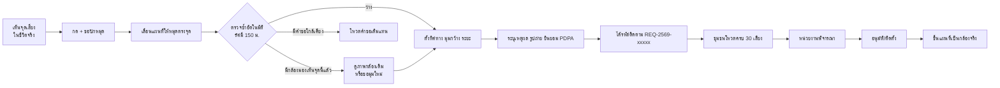
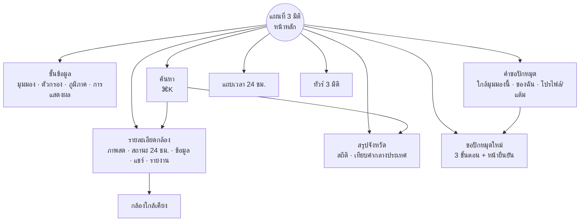

# ตาทิพย์ · เอกสารออกแบบ UX/UI เฟส 1

> แพลตฟอร์มรวมกล้อง CCTV ทั่วประเทศไทยบนแผนที่ 3 มิติ สำหรับประชาชนทั่วไป
> เฟส 1 เน้นออกแบบหน้าตาและประสบการณ์ใช้งาน โดยใช้ **ข้อมูลจำลอง (mockup data)** ทั้งหมด
> ชื่อ "ตาทิพย์" เป็นชื่อชั่วคราวสำหรับโครงการ
> **ระบบนี้ไม่ใช้ AI** ทุกฟังก์ชันทำงานจากข้อมูลที่หน่วยงานและประชาชนให้มา การค้นหาแบบตรงตัว และการคำนวณทางภูมิศาสตร์

ต้นแบบที่คลิกได้จริงอยู่ในโฟลเดอร์ [`prototype/`](../prototype) วิธีเปิดดูอยู่ใน [README](../README.md)

---

## 1. สรุปสั้น

| หัวข้อ | สาระสำคัญ |
|---|---|
| ปัญหา | กล้อง CCTV ในไทยกระจายอยู่หลายหน่วยงาน (กทม. กรมทางหลวง ตำรวจ ท้องถิ่น เอกชน) ไม่มีจุดเดียวให้ประชาชนค้นและดูได้ และไม่มีช่องทางบอกว่า "ตรงนี้ควรมีกล้อง" |
| เป้าหมายเฟส 1 | ได้ภาษาภาพ ระบบออกแบบ และ flow หลักที่ทดสอบกับผู้ใช้จริงได้ ก่อนลงทุนเชื่อมระบบหลังบ้าน |
| แกนของประสบการณ์ | แผนที่ 3 มิติเป็นหน้าหลัก ทุกอย่างเริ่มและจบบนแผนที่ |
| ผู้ใช้หลัก | ประชาชนทั่วไป ใช้ได้โดยไม่ต้องสมัครสมาชิก ส่วนการขอปักหมุดและโหวตใช้บัญชีแบบเบา |
| ส่งมอบ | ต้นแบบเว็บแบบ responsive (เดสก์ท็อป แท็บเล็ต มือถือ), design tokens, เอกสารฉบับนี้, แผนทดสอบผู้ใช้ |

---

## 2. วิเคราะห์ผู้ใช้

### 2.1 Persona

| Persona | ตัวอย่าง | สิ่งที่ต้องการ | สิ่งที่ออกแบบให้ |
|---|---|---|---|
| คนเดินทางประจำ | พนักงานออฟฟิศ ขับรถจากบางนาเข้าอโศก | รู้ว่ารถติดแค่ไหนก่อนออกจากบ้าน | ค้นหาชื่อแยก "อโศก", ปุ่มติดตามกล้อง, แจ้งเตือนเมื่อกล้องออฟไลน์ |
| ไรเดอร์ / คนขับรถส่งของ | วิ่งงานทั้งวันในหลายเขต | เช็กเร็ว มือเดียว บนมือถือ | Bottom sheet แตะครั้งเดียวเห็นภาพสด, ปุ่มใหญ่ ≥ 40px |
| ผู้อยู่ในพื้นที่เสี่ยงน้ำท่วม | ชุมชนริมคลองแสนแสบ | ระดับน้ำจริงตอนฝนตก | กล้องเฝ้าระวังน้ำท่วมที่เห็นเสาวัดระดับน้ำในภาพ |
| คนภาคเหนือช่วงหมอกควัน | ผู้ปกครองในเชียงใหม่ | ค่าฝุ่นจริงก่อนพาลูกออกจากบ้าน | กล้องเฝ้าระวังหมอกควันและไฟป่า ดูสภาพท้องฟ้าจริง |
| นักท่องเที่ยว | ไปภูเก็ต พัทยา | ชายหาดคนเยอะไหม ฝนตกไหม | กล้องท่องเที่ยว ดูภาพชายหาดจริง ทัวร์ 3 มิติ |
| อาสาสมัคร / ผู้นำชุมชน | อาสาเขตบางกะปิ | ผลักดันให้มีกล้องตรงจุดเสี่ยง | ขอปักหมุด ตรวจซ้ำอัตโนมัติ โหวต ติดตามสถานะ |
| เจ้าหน้าที่หน่วยงาน (เฟส 2) | วิศวกรจราจรของเทศบาล | เห็นคำขอที่ผ่านการโหวตในพื้นที่ตัวเอง | พอร์ทัลหน่วยงาน (ออกแบบในเฟส 2) |

### 2.2 งานหลักที่ผู้ใช้ต้องทำได้ (Jobs to be done)

1. **ดูภาพสดของจุดที่สนใจ** ภายใน 3 แตะ/คลิก
2. **ค้นหาด้วยชื่อ** จังหวัด เมือง ชื่อแยก/จุด หรือรหัสกล้อง แล้วบินไปยังตำแหน่งนั้น
3. **เห็นภาพรวมว่าพื้นที่ไหนมีกล้องมาก/น้อย** เพื่อเข้าใจความครอบคลุม
4. **ขอปักหมุดกล้องใหม่** โดยระบบช่วยตรวจว่าซ้ำกับกล้องเดิมหรือคำขอเดิมหรือไม่
5. **ช่วยโหวตและติดตามคำขอ** จนกว่าจะติดตั้ง
6. **ย้อนดูภาพตามช่วงเวลา** เช่น ชั่วโมงเร่งด่วนเช้า

### 2.3 User journey: ขอปักหมุดกล้องใหม่

---

## 3. โครงสร้างข้อมูลบนหน้าจอ (Information Architecture)

หลักการคือ **ไม่มีการเปลี่ยนหน้า** ทุกอย่างเป็นแผงที่ซ้อนบนแผนที่ ผู้ใช้จึงไม่เสียบริบทของตำแหน่งที่ดูอยู่ และกดย้อนกลับ (Esc / ปัดลง) ได้ทุกจุด

---

## 4. รายการหน้าจอ (Screen inventory)

| # | หน้าจอ | เดสก์ท็อป | มือถือ | สถานะในต้นแบบ |
|---|---|---|---|---|
| 1 | แผนที่สำรวจ | แผนที่เต็มจอ แผงลอยซ้าย/ขวา | แผนที่เต็มจอ + bottom nav 5 ปุ่ม | ✅ |
| 2 | ชั้นข้อมูล | แผงซ้าย 320px ซ่อนได้ | bottom sheet | ✅ |
| 3 | รายละเอียดกล้อง | แผงขวา 404px | bottom sheet ครึ่งจอ ปัดขึ้นเต็มจอ | ✅ |
| 4 | สรุปจังหวัด | แผงขวา | bottom sheet | ✅ |
| 5 | ค้นหา | command palette กลางจอ | เต็มความกว้าง | ✅ |
| 6 | ขอปักหมุด (4 ขั้น) | แผงขวา + หมุดกลางจอ | sheet ล่าง + หมุดช่วงบนของจอ | ✅ |
| 7 | คำขอ + โปรไฟล์ | แผงขวา | bottom sheet | ✅ |
| 8 | แถบเวลา 24 ชม. | กลางล่าง | เต็มความกว้างเหนือ nav | ✅ |
| 9 | อัปเดตล่าสุด (สถานะกล้อง/ติดตั้งใหม่) | มุมซ้ายล่าง | ซ่อน (อยู่ในการแจ้งเตือนเฟส 2) | ✅ |
| 10 | ทัวร์ 3 มิติ | การ์ดคำบรรยายล่าง | เหมือนกัน | ✅ |
| 11 | หน้าโหลด (boot) | ไม่เกิน 1 วินาที | เหมือนกัน | ✅ |
| 12 | เข้าสู่ระบบแบบเบา (LINE / เบอร์โทร OTP) | — | — | เฟส 2 |
| 13 | ศูนย์แจ้งเตือน / กล้องที่ติดตาม | — | — | เฟส 2 |
| 14 | พอร์ทัลหน่วยงาน / แอดมินตรวจคำขอ | — | — | เฟส 2 |
| 15 | มุมมองรายการ (สำหรับ screen reader) | — | — | เฟส 2 |

---

## 5. การออกแบบแผนที่ 3 มิติ

### 5.1 แนวคิดภาพ: "ไฟโซเดียมยามค่ำ"

ประเทศไทยยามค่ำคืนมองจากฟ้า กล้องแต่ละตัวคือดวงไฟ เส้นทางหลวงคือสายแสงของรถที่เคลื่อนไป สีหลักคือ **อำพันของไฟถนนโซเดียม** ที่คนไทยเห็นทุกคืน ประเทศไทยถูกยกเป็น "แผ่นโฮโลแกรม" ลอยเหนือประเทศเพื่อนบ้าน มีขอบเรืองแสงสีอำพัน

ธีมกลางวันใช้ภาษาเดียวกันแต่กลับค่า: แผ่นประเทศสีขาวนวล อาคารสีขาว เงาเทา สีอำพันเข้มขึ้นเพื่อให้ตัดกับพื้นสว่าง

### 5.2 ระดับรายละเอียดตามการซูม (Level of Detail)

| ระดับ | ซูม | สิ่งที่เห็น | เหตุผล |
|---|---|---|---|
| ประเทศ | 4–7 | แผ่นประเทศ 3D ยกตัว, เส้นจังหวัด, จุดกล้องทั้งหมดเหมือนดวงไฟ, สายแสงทางหลวง, ชื่อเมืองหลักและประเทศเพื่อนบ้าน | เห็นภาพรวมทั้งประเทศใน 1 จอ |
| ภูมิภาค | 7–11 | ชื่อเมืองรอง, หมุดคำขอ, กระแสจราจรระหว่างเมือง | เลือกพื้นที่ที่สนใจ |
| เมือง | 11–14 | อาคาร 3D (digital twin จำลอง), รถวิ่งตามถนนในเมือง, แสงไฟอาคารยามค่ำ | รู้สึกว่ากำลัง "อยู่ในเมือง" |
| ถนน | 14+ | กรวยมุมมอง (FOV) ของทุกกล้อง, ป้ายชื่อแยก/จุดสำคัญ, กรวยกวาดของกล้อง PTZ, ลำแสงชี้กล้องที่เลือก | ตอบได้ว่ากล้องนี้ "มองเห็นอะไร" |

ความหนาของแผ่นประเทศ ความสูงของแท่ง และความยาวหางรถ ปรับตามระดับซูมให้คงขนาดบนจอ ทำให้ภาพสมดุลทุกระดับ

### 5.3 มุมมองแผนที่ 4 แบบ

| มุมมอง | ใช้ตอบคำถาม | การเข้ารหัสภาพ |
|---|---|---|
| จุดกล้อง | กล้องอยู่ตรงไหน ประเภทอะไร ทำงานไหม | สี = ประเภท, จุดทึบ = ออนไลน์, จุดเทา = ออฟไลน์, จุดจาง = ซ่อมบำรุง |
| หนาแน่น 3D | ตรงไหนมีกล้องหนาแน่น | แท่งหกเหลี่ยม สูง/สีตามจำนวนกล้อง ความสูงเปลี่ยนตามแถบเวลา |
| รายจังหวัด | จังหวัดไหนครอบคลุมดี/น้อย | แท่งจังหวัดสูงตามกล้องต่อ 100 ตร.กม. สีสเกล log ให้เห็นความต่างของจังหวัดเล็ก |
| คำขอ | ประชาชนอยากได้กล้องตรงไหน | heatmap ถ่วงน้ำหนักด้วยคะแนนโหวต + หมุดวงแหวนกลวง |

### 5.4 ภาษาภาพของวัตถุบนแผนที่

| วัตถุ | รูปแบบ |
|---|---|
| กล้อง | จุดสีตามประเภท + แสงฟุ้ง (ธีมมืด) + ขอบขาวเมื่อซูมใกล้ |
| กล้องที่เลือก | ลำแสงตั้งฉาก + วงคลื่นกระจาย + กรวยมุมมองสว่าง + ป้ายชื่อลอย |
| กรวยมุมมอง | สามเหลี่ยมโค้งตามทิศ มุมกว้าง และระยะจริงของกล้อง |
| คำขอปักหมุด | วงแหวนกลวง (ยังไม่มีอยู่จริง) คำขอของฉันเป็นสีอำพันพร้อมคลื่น |
| กระแสจราจร | สายแสงหางยาว ความเร็วและความหนาแน่นตามชั่วโมง |

### 5.5 การควบคุม

- เมาส์: ลากเพื่อเลื่อน, ปุ่มขวา/Ctrl+ลากเพื่อหมุนและเอียง, ล้อเพื่อซูม
- นิ้ว: ปัดเลื่อน, บีบซูม, สองนิ้วหมุน/เอียง
- ปุ่มบนจอ: ซูม, เข็มทิศ (แตะเพื่อหันทิศเหนือขึ้น), สลับ 2D/3D, ตำแหน่งของฉัน, ทัวร์
- คีย์บอร์ด: ⌘K หรือ `/` เปิดค้นหา, Esc ปิดแผงบนสุด, ลูกศรเลื่อนแผนที่

---

## 6. Flow หลักโดยละเอียด

### 6.1 ดูกล้อง

1. แตะจุดกล้อง หรือเลือกจากผลค้นหา/การแจ้งเตือน
2. กล้องบินเข้าซูมระดับถนน เอียง 60° และจัดให้จุดกล้องไม่ถูกแผงบัง (เดสก์ท็อปเลื่อนไปซ้าย มือถือเลื่อนขึ้นบน)
3. แผงรายละเอียดเปิดพร้อม **ภาพสด** มุมกรอบช่องมองภาพ, ไฟ REC, เวลา พ.ศ.
4. ด้านล่างเป็น **แถบสถานะการเชื่อมต่อ 24 ชม.** (48 ช่อง ช่องละครึ่งชั่วโมง: เขียว = ออนไลน์, แดง = ออฟไลน์, เหลือง = ซ่อมบำรุง) และข้อมูลกล้อง: หน่วยงานเจ้าของ ทิศทาง/มุมกว้าง คุณภาพสัญญาณ ความพร้อมใช้งาน 30 วัน ปีที่ติดตั้ง พิกัด
   - ภาพในกล้องเป็นภาพดิบจากหน่วยงานเจ้าของ ระบบไม่วิเคราะห์หรือดัดแปลงภาพ
5. กล้อง PTZ หมุนได้จากปุ่ม ◀ ▶ และ **กรวยบนแผนที่หมุนตามทันที** (ภาพกับแผนที่เชื่อมกัน)
6. การกระทำ: นำทาง, แชร์ (ลิงก์ตรงถึงกล้อง `#cam-<รหัส>`), ติดตาม, รายงานปัญหา

### 6.2 ค้นหา

- พิมพ์ชื่อจังหวัด (ไทย/อังกฤษ) เมือง ชื่อแยก/จุด หรือรหัสกล้อง → ผลแบ่งกลุ่ม จังหวัด / เมืองและพื้นที่ / กล้อง
- ยังไม่พิมพ์: แสดงจุดสำคัญ ค้นหาล่าสุด และจังหวัดยอดนิยม ให้แตะได้ทันที
- เลื่อนด้วยลูกศร กด Enter เพื่อไป ไม่พบผลจะบอกตัวอย่างคำที่ค้นได้
- ต้องการกรองตามประเภท/สถานะ ใช้ชิปในแผงชั้นข้อมูล

### 6.3 ขอปักหมุดกล้องใหม่ (หัวใจของการมีส่วนร่วม)

| ขั้น | สิ่งที่ผู้ใช้ทำ | สิ่งที่ระบบช่วย |
|---|---|---|
| 1. เลือกตำแหน่ง | เลื่อนแผนที่ให้หมุดตรงจุด (หมุดค้างกลางจอแบบแอปเรียกรถ) แตะแผนที่เพื่อย้ายเร็ว ค้นหาสถานที่ หรือใช้ตำแหน่งของฉัน | บังคับซูมระดับถนน, แสดงพิกัดและจังหวัด, **ตรวจซ้ำสด** ในรัศมี 150 ม.: เส้นเชื่อมไปกล้องใกล้เคียง และไฮไลต์สีแดงถ้ากรวยของกล้องเดิมมองเห็นจุดนี้แล้ว, เสนอให้โหวตคำขอใกล้เคียงแทน |
| 2. ทิศทางและมุมมอง | เลือกประเภท, ลากวงทิศทาง, ปรับมุมกว้าง/ระยะ, เลือก "ติดตั้งใหม่" หรือ "มีอยู่แล้ว ขอแชร์ภาพ" | กรวยตัวอย่างบนแผนที่ 3D ขยับตามแบบเรียลไทม์, ตั้งทิศเริ่มต้นให้หันออกจากกล้องเดิม |
| 3. รายละเอียด | ชื่อจุด (เติมให้อัตโนมัติจากจุดสำคัญใกล้สุด), ชิปเหตุผลด่วน, คำอธิบาย, รูปหน้างาน, ช่องทางติดต่อ (ไม่เปิดเผย), ยินยอม PDPA | ตรวจความครบถ้วนแบบแจ้งเตือนใต้ช่อง ไม่ใช้ popup |
| 4. ยืนยัน | ได้รหัส `REQ-2569-xxxxx` และไทม์ไลน์สถานะ | หมุดของฉันขึ้นแผนที่ทันที, ปุ่ม "ชวนเพื่อนโหวต" |

สถานะคำขอ: `ส่งคำขอแล้ว → รอชุมชนยืนยัน (30 เสียง) → หน่วยงานพิจารณา → อนุมัติ รอติดตั้ง → เผยแพร่บนแผนที่` (หรือ `ไม่ผ่านการพิจารณา` พร้อมเหตุผล)

### 6.4 ชุมชนและแรงจูงใจ

- แท็บ "ใกล้มุมมองนี้" เรียงคำขอตามระยะจากจุดที่ผู้ใช้กำลังดู
- โหวตได้คนละ 1 เสียงต่อคำขอ แถบความคืบหน้า x/30
- แต้มและระดับ "ผู้พิทักษ์ชุมชน Lv.n" (ขอปักหมุด +50, โหวต +5) เป็นแรงจูงใจเบา ๆ ไม่ใช่เกมเต็มรูปแบบ

### 6.5 แถบเวลา (Time machine)

- เส้นกราฟใต้แถบแสดงช่วงเวลาเร่งด่วนโดยประมาณ ช่วยให้เลือกช่วงเวลาที่จะย้อนดูได้เร็ว
- ลากเพื่อดูช่วงเวลาอื่น หรือกด ▶ เล่น 24 ชม. ภายในราว 20 วินาที
- สิ่งที่เปลี่ยนตาม: แสงอาทิตย์/ดวงจันทร์บนแผนที่, ความเร็วและความหนาแน่นของรถ, ความสูงแท่งหนาแน่น, ภาพในกล้อง (กลางวัน/กลางคืน/ไฟหน้ารถ), ไฟ REC เปลี่ยนเป็น "บันทึก"
- ปุ่ม "กลับสู่สด" ชัดเจนเสมอ

---

## 7. ระบบออกแบบ (Design system)

### 7.1 สี

| Token | กลางวัน | กลางคืน | ใช้กับ |
|---|---|---|---|
| `--bg` | `#DCE4EA` | `#050A10` | พื้นหลังทะเล |
| `--glass` | ขาว 84% | น้ำเงินเข้ม 74% | แผงกระจกลอย (backdrop blur 18px) |
| `--fg` / `--fg-2` / `--fg-3` | `#0D1A24` / `#475867` / `#7A8A97` | `#E7EEF3` / `#93A4B2` / `#627382` | ข้อความหลัก/รอง/คำอธิบาย |
| `--accent` | `#C77700` | `#FFB238` | แบรนด์ ปุ่มหลัก ขอบประเทศ (อำพันโซเดียม) |
| `--signal` | `#0B8C86` | `#3FD6CF` | ข้อมูลเชิงระบบ, privacy |
| `--ok` / `--warn` / `--bad` | เขียว / เหลืองอำพัน / แดง | สว่างขึ้น | สถานะ (แยกจากสีแบรนด์) |

สีประเภทกล้อง (ทุกสีผ่านการปรับคู่ให้อ่านได้ทั้งสองธีม)

| ประเภท | กลางวัน | กลางคืน |
|---|---|---|
| จราจร | `#C77700` | `#FFB238` |
| ความปลอดภัย | `#2B68D6` | `#5C9CFF` |
| เฝ้าระวังน้ำท่วม | `#008A8A` | `#38D6CF` |
| ท่องเที่ยว | `#CF3378` | `#FF6FA8` |
| ชุมชนแชร์ | `#3F8F22` | `#8CD65A` |
| หมอกควัน/ไฟป่า | `#7650D6` | `#AA8CFF` |

ระดับ PM2.5 ใช้เกณฑ์ของไทย: 0–15 ดีมาก, 15.1–25 ดี, 25.1–37.5 ปานกลาง, 37.6–75 เริ่มมีผลกระทบ, >75 มีผลกระทบต่อสุขภาพ

### 7.2 ตัวอักษร

| บทบาท | ฟอนต์ | เหตุผล |
|---|---|---|
| Display / ตัวเลข | **Chakra Petch** 500–700 | ฟอนต์ไทย-ละตินทรงเหลี่ยมแบบเทคโนโลยี ให้บุคลิก HUD โดยยังอ่านภาษาไทยง่าย |
| เนื้อหา | **Anuphan** 400–600 | ไทยไม่มีหัว ทันสมัย อ่านง่ายบนจอเล็ก |
| ข้อมูล/รหัส/พิกัด | **JetBrains Mono** | ตัวเลขกว้างเท่ากัน เหมาะกับรหัสกล้อง เวลา พิกัด |

สเกล: 12 / 13 / 15 / 18 / 24 / 32 px · บรรทัด 1.5 · **ไม่ใส่ letter-spacing กับข้อความไทย** (สระและวรรณยุกต์จะลอยห่าง) ใช้เฉพาะกับละตินตัวพิมพ์ใหญ่

### 7.3 รูปทรง ระยะ และพื้นผิว

- รัศมีมุม 8 / 12 / 18 / pill
- ระยะห่างฐาน 4px ขอบจอขั้นต่ำ 16px และเคารพ safe area ของมือถือ
- แผงทั้งหมดเป็นกระจกฝ้า (glass) มีเส้นขอบบาง 1px เพื่อแยกชั้นจากแผนที่โดยไม่บังภาพ
- เน้นด้วยรูปทรงเฉพาะเรื่อง: **มุมช่องมองภาพ (viewfinder brackets)** ที่ภาพกล้อง, ไฟ REC กะพริบ

### 7.4 การเคลื่อนไหว

| จังหวะ | ระยะเวลา | ใช้กับ |
|---|---|---|
| ไมโคร | 150–200ms | hover, กดปุ่ม |
| แผง | 350–380ms `cubic-bezier(.2,.8,.2,1)` | แผงเลื่อนเข้า, sheet |
| กล้องบิน | 1.7–2.6 วินาที (fly-to) | เลือกกล้อง, ค้นหา, ภูมิภาค |
| ช่วงเปิดตัว | ~1 วินาที | ประเทศยกตัวขึ้นจากระนาบ กล้องสว่างเป็นคลื่นจากกรุงเทพฯ ออกไป |

ผู้ใช้ที่ตั้ง "ลดการเคลื่อนไหว" (prefers-reduced-motion) จะไม่เห็นการบิน คลื่น หรือรถวิ่ง แต่ข้อมูลครบเท่าเดิม

### 7.5 คอมโพเนนต์

ปุ่ม (หลัก/รอง/ไอคอน), ชิปตัวกรอง (มีจุดสี + จำนวน), segmented control, สวิตช์, pill สถานะ, การ์ดสถิติ, การ์ด insight พร้อมมิเตอร์และ sparkline, การ์ดคำขอพร้อมไทม์ไลน์, command palette, bottom sheet ลากได้, วงทิศทาง (dial), toast, ป้ายชื่อบนแผนที่ (เมือง/จังหวัด/จุดสำคัญ/กล้องที่เลือก)

---

## 8. Responsive และทุกอุปกรณ์

| ช่วงจอ | เลย์เอาต์ |
|---|---|
| ≥ 1181px (เดสก์ท็อป) | แผงชั้นข้อมูลซ้าย + อัปเดตล่าสุดซ้ายล่าง + แผงรายละเอียดขวา + แถบเวลากลางล่าง |
| 900–1180px (แล็ปท็อปเล็ก / แท็บเล็ตแนวนอน) | เหมือนเดสก์ท็อป ซ่อนอัปเดตล่าสุด |
| < 900px (มือถือ / แท็บเล็ตแนวตั้ง) | ค้นหาเต็มแถว + แถบสถิติเลื่อนได้, ทุกแผงเป็น bottom sheet (สูงสุด 640px กลางจอบนแท็บเล็ต), bottom nav 5 ปุ่ม ปุ่ม + อยู่กลาง, หมุดปักตำแหน่งยกขึ้นไปที่ 30% ของจอเพื่อไม่ให้ sheet บัง |

- เป้าสัมผัสขั้นต่ำ 40×40px
- รองรับรอยบากและแถบระบบด้วย `env(safe-area-inset-*)`
- รายละเอียดกล้องบนมือถือเปิดครึ่งจอก่อน (peek) เพื่อให้ยังเห็นแผนที่ ปัดขึ้นเพื่อดูเต็ม ปัดลงเพื่อปิด
- เฟส 2: ทำเป็น PWA ติดตั้งลงหน้าจอได้ ทำงานออฟไลน์บางส่วน และรับแจ้งเตือนได้

---

## 9. นวัตกรรมที่ใช้

| นวัตกรรม | ประโยชน์ต่อผู้ใช้ | ในต้นแบบ | แผนต่อยอด |
|---|---|---|---|
| แผนที่โฮโลแกรม 3D + LOD 4 ระดับ | เข้าใจภาพรวมและลงลึกถึงระดับถนนในที่เดียว | ✅ deck.gl ไม่พึ่ง tile ภายนอก | MapLibre GL v5 (globe) + vector tiles ไทย + ภูมิประเทศจริง |
| Digital twin เมือง | รู้ทิศทางกล้องเทียบกับตึกและถนนจริง | ✅ อาคารจำลอง | Photorealistic 3D Tiles / อาคาร OSM และ 3D Gaussian Splatting ของจุดสำคัญ |
| กรวยมุมมองกล้อง (FOV) | เห็นว่ากล้องมองอะไร และตรงไหนเป็นช่องว่าง | ✅ | คำนวณการบังสายตาจากอาคาร (viewshed) |
| สถานะการเชื่อมต่อ 24 ชม. | รู้ว่ากล้องเชื่อถือได้แค่ไหนก่อนพึ่งพา | ✅ | ดึงจากระบบตรวจสัญญาณ (health check) ของ gateway |
| ตรวจซ้ำด้วยระยะและมุมมอง | ลดคำขอซ้ำ รวมเสียงไปที่คำขอเดียว | ✅ คำนวณระยะ ทิศ และมุมกว้าง | คำนวณ viewshed จากความสูงอาคารจริง |
| ย้อนเวลา 24 ชม. | ดูภาพช่วงเวลาที่พลาดไป | ✅ | เชื่อมคลิปย้อนหลังจากเครื่องบันทึกของหน่วยงาน |
| ชุมชนโหวต + แต้ม | ประชาชนมีส่วนกำหนดจุดติดตั้ง | ✅ | เชื่อม LINE OA แจ้งความคืบหน้า |
| อัปเดตล่าสุดของเครือข่าย | รู้ว่ากล้องไหนออฟไลน์/กลับมา/ติดตั้งใหม่ | ✅ | Push notification ตามกล้องที่ติดตาม |
| ทัวร์ 3 มิติ | เปิดตัว/สาธิตต่อผู้บริหารและสื่อ | ✅ | ทัวร์ตามเหตุการณ์ เช่น สงกรานต์ ลอยกระทง |
| ตั้งทิศด้วยเข็มทิศมือถือ | ยกมือถือหันไปทางที่อยากให้กล้องมอง ระบบอ่านทิศจากเข็มทิศ/ไจโร | — | เฟส 3 |

---

## 10. การเข้าถึง (Accessibility) และภาษา

- เป้าหมาย WCAG 2.2 ระดับ AA: คอนทราสต์ข้อความ ≥ 4.5:1 ทั้งสองธีม
- ทุกปุ่มมีชื่อสำหรับ screen reader (`aria-label`) และมีกรอบโฟกัสชัดเจนสีอำพัน
- ใช้งานด้วยคีย์บอร์ดได้: palette เลื่อนด้วยลูกศร, dial ทิศทางปรับด้วยลูกศร, การ์ดคำขอกด Enter ได้
- สถานะไม่สื่อด้วยสีอย่างเดียว ต้องมีข้อความหรือรูปทรงประกอบ (pill มีคำ, คำขอเป็นวงแหวนกลวง)
- เฟส 2 เพิ่ม "มุมมองรายการ" ทดแทนแผนที่สำหรับผู้ใช้ screen reader
- ภาษา: เขียนแบบที่คนทั่วไปพูด, เวลา 24 ชม. ตามด้วย "น.", ปี พ.ศ., ระยะทาง ม./กม., ตัวเลขคั่นหลักพัน, ข้อผิดพลาดบอกวิธีแก้เสมอ (เช่น "เข้าถึงตำแหน่งไม่ได้ ลองค้นหาสถานที่หรือเลื่อนแผนที่เองแทน")

---

## 11. ความเป็นส่วนตัวและความน่าเชื่อถือ (มุม UX)

- ข้อความแจ้งว่าภาพมาจากหน่วยงานเจ้าของและเผยแพร่ภายใต้ PDPA อยู่ใต้ภาพกล้องทุกตัว พร้อมช่องทางรายงาน
- ข้อมูลติดต่อในคำขอไม่เปิดเผยต่อสาธารณะ และระบุชัดในฟอร์ม
- ต้องกดยินยอมก่อนส่งคำขอ (PDPA)
- ปุ่ม "รายงาน" มีตัวเลือก "ภาพละเมิดความเป็นส่วนตัว" เพื่อให้ถอดกล้องออกได้เร็ว
- ป้าย "ข้อมูลจำลอง" ปรากฏตลอดในต้นแบบ เพื่อไม่ให้ผู้ทดสอบเข้าใจผิดว่าเป็นภาพจริง

---

## 12. แผนทดสอบผู้ใช้ (เฟส 1)

| หัวข้อ | รายละเอียด |
|---|---|
| ผู้เข้าร่วม | 6–8 คนต่อกลุ่ม: คนเดินทางประจำ, ไรเดอร์, ผู้สูงอายุ 55+, อาสาชุมชน, ผู้ใช้มือถือเป็นหลัก |
| รูปแบบ | ทดสอบแบบมีผู้ดำเนินการ 45 นาที ทั้งบนมือถือจริงและเดสก์ท็อป |
| งานทดสอบ | 1) หาภาพกล้องแยกอโศก 2) หากล้องเฝ้าระวังน้ำท่วมใกล้บ้าน 3) ดูว่าเชียงใหม่มีกล้องกี่ตัว 4) ขอปักหมุดกล้องหน้าโรงเรียน 5) โหวตคำขอใกล้บ้าน 6) ย้อนดูภาพแยกอโศกตอน 08:00 |
| ตัวชี้วัด | อัตราทำงานสำเร็จ ≥ 85%, เวลาถึงภาพกล้องแรก < 20 วินาที, SUS ≥ 75, จำนวนคำขอซ้ำที่ระบบดักได้ |
| สิ่งที่อยากรู้ | แผนที่ 3D ช่วยหรือทำให้สับสน, ผู้สูงอายุใช้ท่าทางหมุน/เอียงได้หรือไม่, ผู้ใช้ค้นหาเจอจุดที่ต้องการด้วยคำที่ตัวเองใช้หรือไม่, 30 เสียงเหมาะสมหรือไม่ |

---

## 13. ส่งมอบเฟส 1 และแผนถัดไป

### 13.1 ส่งมอบเฟส 1 (UX/UI)

1. ต้นแบบเว็บแบบคลิกได้ (โฟลเดอร์ `prototype/`) พร้อมไฟล์เดี่ยว `dist/tathip.html` สำหรับแชร์
2. Design tokens (สี ตัวอักษร ระยะ การเคลื่อนไหว) ในรูป CSS variables พร้อมนำไปใช้ต่อ
3. เอกสารฉบับนี้ (IA, flow, หน้าจอ, ระบบออกแบบ, นวัตกรรม, แผนทดสอบ)
4. ผลทดสอบผู้ใช้และรายการปรับปรุง (หลังรอบทดสอบ)

### 13.2 ภาพรวมเฟสถัดไป

| เฟส | ขอบเขต |
|---|---|
| 2: ระบบจริงขั้นต้น | บัญชีผู้ใช้แบบเบา (LINE Login / OTP), API กล้องและคำขอ, ฐานข้อมูลพิกัด (PostgreSQL + PostGIS), แอดมินตรวจคำขอ, พอร์ทัลหน่วยงาน, PWA |
| 3: ภาพสด | Gateway สตรีม (RTSP → WebRTC/HLS), ตรวจสถานะสัญญาณ, คลิปย้อนหลัง, แจ้งเตือน push |
| 4: ขยายทั่วประเทศ | เชื่อม API หน่วยงานต่าง ๆ, vector tiles ของไทยเอง, Photorealistic 3D, มาตรฐานข้อมูลเปิด, SLA และการกำกับดูแลข้อมูล |

เทคโนโลยีหน้าบ้านที่แนะนำสำหรับระบบจริง: React/Next.js + TypeScript, MapLibre GL JS + deck.gl (`MapboxOverlay`), vector tiles (PMTiles), ใช้ design tokens จากต้นแบบนี้โดยตรง

---

## 14. หมายเหตุเกี่ยวกับข้อมูลจำลอง

- ขอบเขต 77 จังหวัดจาก `@svg-maps/thailand` (CC BY 4.0) แปลงเป็นพิกัดภูมิศาสตร์โดยประมาณ ขอบชายฝั่งจึงคลาดเคลื่อนได้ราว 1 กม.
- ประเทศเพื่อนบ้านจาก Natural Earth (public domain) ผ่าน `world-atlas`
- กล้อง 4,660 ตัว คำขอ 52 รายการ ทางหลวง อาคาร กระแสจราจร และสถานะทั้งหมดสร้างขึ้นด้วยการสุ่มแบบกำหนด seed (ทุกคนเห็นชุดเดียวกัน) ชื่อจุดสำคัญใช้ชื่อสถานที่จริงเพื่อความสมจริงในการทดสอบ แต่ตำแหน่ง สถานะ และภาพทั้งหมดไม่ใช่ข้อมูลจริง
- ภาพสดเป็นภาพวาดด้วย canvas ไม่มีการเชื่อมต่อกล้องจริง
